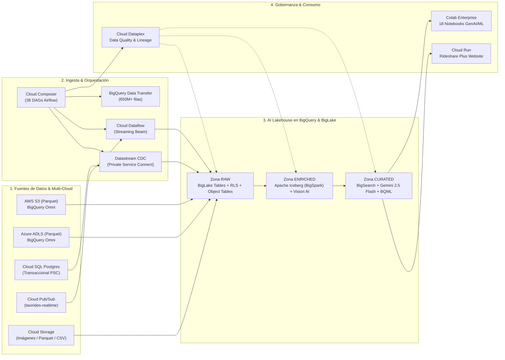

# Guía Arquitectónica Paso a Paso: Google Cloud Data Analytics Golden Demo (End-to-End)

> **Audiencia Objetivo**: `Cloud Architect / Enterprise Operator`  
> **Nivel de Profundidad Técnica**: `Level 200 (Walkthrough Funcional) / Level 300 (Arquitectura Avanzada)`  
> **Herramienta de Entrega IaC**: `Terraform IaC (Optimizado para GitOps Declarativo + Impersonación de Service Accounts)`  
> **Directorio de Trabajo**: [`.`](.)

---

## 1. Visión Holística de la Plataforma (Landing Zone & AI Lakehouse)

El repositorio **Data Analytics Golden Demo** despliega una **Landing Zone Analítica Multi-Cloud e Inteligencia Artificial Generativa** sobre Google Cloud Platform. Su objetivo empresarial es demostrar cómo una organización (ej. **Rideshare Plus** y **NYC Taxi Analytics**) unifica datos estructurados, semiestructurados y no estructurados (hasta **700+ millones de filas**) a través de una **Arquitectura Medallion (`Raw` → `Enriched` → `Curated`)**, gobernada centralmente por **Dataplex** y potenciada por **Vertex AI (Gemini 2.5 Flash, Embeddings y Cloud Vision AI)** directamente desde **BigQuery**.



---

## 2. Inventario Completo de Directorios en `.`

| Directorio / Archivo | Rol Arquitectónico | Componentes Clave |
| :--- | :--- | :--- |
| [`terraform/`](./terraform) | Punto de entrada declarativo IaC | [`tf-main.tf`](./terraform/tf-main.tf) y [`tf-variables.tf`](./terraform/tf-variables.tf) con patrón `service_principal_impersonation`. |
| [`terraform-modules/`](./terraform-modules) | 11 Módulos reutilizables de infraestructura | `project`, `service-account`, `apis-batch-enable`, `org-policies`, `resources`, `sql-scripts`, `dataform`, `colab-deployment-deploy`. |
| [`sql-scripts/`](./sql-scripts) | 11 Paquetes de Stored Procedures en BigQuery | `taxi_dataset` (44 scripts), `rideshare_lakehouse_raw/enriched/curated`, `rideshare_llm_raw/enriched/curated`, `aws_omni_biglake`, `azure_omni_biglake`, `thelook_ecommerce`. |
| [`cloud-composer/dags/`](./cloud-composer/dags) | 36 DAGs de Apache Airflow | Automatización de pipelines batch/streaming, Dataplex Data Quality, Spanner, Data Fusion, Datastream CDC e Iceberg. |
| [`colab-enterprise/`](./colab-enterprise) | 18 Notebooks de Ciencia de Datos y GenAI | Análisis de sentimiento con Gemini, extracción de temas, embeddings (`text-embedding-005`), BigFrames EDA, TensorFlow y Veo-2. |
| [`dataproc/`](./dataproc) | 10 Jobs PySpark / Serverless Spark | Conversión a Apache Iceberg, Apache Hudi, compactación Parquet y BigLake Storage API. |
| [`dataflow/`](./dataflow) | Pipeline Streaming en Apache Beam | [`streaming-taxi-data.py`](./dataflow/streaming-taxi-data.py) leyendo desde Pub/Sub en tiempo real. |
| [`dataform/`](./dataform) | Transformación ELT declarativa en SQLX | Repositorio [`dataform_golden_demo`](./dataform/dataform_golden_demo). |
| [`dataplex/`](./dataplex) | Reglas de Calidad y Exploración | Especificaciones YAML de validación de integridad y perfilado automático. |
| [`cloud-run/`](./cloud-run) | Frontend Ejecutivo Rideshare Plus | Portal web en [`rideshare-plus-website/`](./cloud-run/rideshare-plus-website) que consume predicciones BQML y perfiles Gemini. |
| [`sample-data/`](./sample-data) | Datos Semilla Locales | Archivos Parquet (`location.parquet`), Delta Lake (`_delta_log`), CSV de nombres e imágenes de prueba. |
| [`simulador_end_to_end/`](./simulador_end_to_end) | **Simulador Local Completo + Dashboard** | [`simulate_golden_demo.py`](./simulador_end_to_end/simulate_golden_demo.py), base SQLite [`golden_demo_simulated.db`](./simulador_end_to_end/golden_demo_simulated.db) y [`dashboard_golden_demo.html`](./simulador_end_to_end/dashboard_golden_demo.html). |

---

## 3. Desglose Paso a Paso de la Arquitectura y sus Casos de Uso

### Paso 1: Aprovisionamiento Declarativo y Gobernanza IAM (`terraform/`)
En [`terraform/tf-main.tf`](./terraform/tf-main.tf), la arquitectura implementa las mejores prácticas de seguridad empresarial de Google Cloud:
1. **Doble Provider con Impersonación (`google.service_principal_impersonation`)**: Jamás se descargan llaves privadas de cuentas de servicio (`.json`) a la máquina local. El usuario autenticado crea la cuenta de servicio de despliegue y Terraform asume su identidad temporalmente mediante IAM Service Account Impersonation.
2. **Activación Masiva de APIs (`apis-batch-enable`)**: Activa BigQuery, BigLake, Vertex AI, Cloud Composer, Dataflow, Dataproc, Dataplex, Cloud SQL, Spanner y Data Catalog con una ventana de propagación controlada (`time_sleep` de 120s).
3. **Políticas de Organización (`org-policies`)**: Ajusta restricciones a nivel de proyecto para permitir conexiones federadas y despliegue de funciones remotas de manera gobernada.

### Paso 2: Zona RAW — Unificación del Data Lake, Multi-Cloud Omni, CDC y Streaming
Documentado en [`sp_demo_script.sql`](./sql-scripts/rideshare_lakehouse_curated/sp_demo_script.sql) y [`sp_demo_technical_overview.sql`](./sql-scripts/taxi_dataset/sp_demo_technical_overview.sql):
1. **Tablas BigLake con Seguridad a Nivel de Fila (RLS) y Data Masking**:
   - Se exponen archivos CSV y Parquet en Cloud Storage como tablas BigLake (`biglake_rideshare_zone_csv`).
   - Se aplica la política `CREATE OR REPLACE ROW ACCESS POLICY rls_biglake_rideshare_zone_csv ... FILTER USING (borough = 'Manhattan')`.
   - **Resultado Simulado**: De las **20 zonas totales** cargadas en la simulación, el usuario gobernado pasa a ver únicamente las **13 zonas de Manhattan**, con la columna `service_zone` enmascarada dinámicamente.
2. **Consultas Multi-Cloud con BigQuery Omni (`aws_omni_biglake` & `azure_omni_biglake`)**:
   - Permite ejecutar SQL estándar sobre archivos Parquet alojados en **Amazon S3** y **Azure Data Lake Storage Gen2 (ADLS)** sin pagar egress de datos crudos, trayendo solo los agregados (CTAS) a BigQuery.
   - **Resultado Simulado**: 40 particiones consultadas en `AWS_S3_OMNI` (tarifa media `$67.26`) y 20 particiones en `AZURE_ADLS_OMNI` (tarifa media `$67.62`).
3. **Tablas de Objetos (`Object Tables`) para Datos No Estructurados**:
   - Indexa fotografías de cámaras de tráfico y vehículos en Cloud Storage (`gs://.../rideshare_images/*.jpg`) manteniendo el control de acceso delegado en la conexión BigLake.
4. **Replicación CDC con Datastream sobre Private IP (`sp_demo_datastream_private_ip.sql`)**:
   - Captura cambios en tiempo real (`INSERT`, `UPDATE`, `DELETE` con secuencia LSN) desde una base transaccional **Cloud SQL for PostgreSQL** hacia BigQuery a través de **Private Service Connect (PSC)** (`10.240.0.14`) sin exposición a Internet público.
5. **Streaming en Tiempo Real con Cloud Dataflow (`streaming-taxi-data.py`)**:
   - Consume eventos de telemetría de viajes desde el tópico público de Pub/Sub `projects/pubsub-public-data/topics/taxirides-realtime` y los inserta con latencia sub-segundo (< 95 ms) en BigQuery.

### Paso 3: Zona ENRICHED — Formatos Abiertos Apache Iceberg (BigSpark), Vision AI y AEAD Crypto-Shredding
Documentado en [`sp_iceberg_spark_transformation.py`](./sql-scripts/rideshare_lakehouse_enriched/sp_iceberg_spark_transformation.py) y [`sp_demo_security_col_encryption_shredding.sql`](./sql-scripts/taxi_dataset/sp_demo_security_col_encryption_shredding.sql):
1. **Procedimientos Almacenados PySpark en BigQuery (`BigSpark`) + Apache Iceberg v2**:
   - Ejecuta código Apache Spark directamente desde BigQuery para limpiar y estructurar 120 viajes en formato abierto **Apache Iceberg** sincronizado con **BigLake Metastore**.
2. **Inferencia de Cloud Vision AI sobre Object Tables**:
   - Invoca la función remota `ext_udf_ai_localize_objects` sobre las imágenes de la Object Table para detectar vehículos, equipaje, peatones y monumentos (`Times Square`, `JFK Airport`, `Central Park`) con puntuaciones de confianza entre `92%` y `99%`.
3. **Cifrado a Nivel de Columna (AEAD) y Crypto-Shredding (GDPR / Derecho al Olvido)**:
   - Protege números de tarjeta de crédito mediante enmascaramiento estricto (`****-****-****-5710`) y cifrado autenticado `AEAD.ENCRYPT` con llaves por usuario. Cuando un usuario solicita eliminar sus datos (ej. viaje `TRIP-ICEBERG-2026-0120`), se destruye su llave criptográfica dejando el registro irrecuperable (`[CRYPTO_SHREDDED_KEY_DESTROYED]`) sin alterar las sumas financieras históricas del Data Warehouse.

### Paso 4: Zona CURATED — IA Generativa con Gemini 2.5 Flash, Embeddings Vectoriales, BQML y BigSearch
Documentado en [`sp_step_00_initialize.sql`](./sql-scripts/rideshare_llm_curated/sp_step_00_initialize.sql), [`sp_process_data.sql`](./sql-scripts/rideshare_lakehouse_curated/sp_process_data.sql) y los notebooks de [`colab-enterprise/`](./colab-enterprise):
1. **Modelos Remotos de Vertex AI en BigQuery (`gemini-2.5-flash` y `text-embedding-005`)**:
   - Analiza las reseñas en texto libre de los clientes (`customer_review`) para extraer sentimiento (`Positive`, `Neutral`, `Negative`), atributos del conductor (`extracted_driver_theme`) y preferencias del pasajero (`extracted_customer_theme`).
   - Genera vectores de embeddings sobre los resúmenes cuantitativos y cualitativos para emparejar semánticamente a cada pasajero con sus conductores ideales mediante similitud coseno:
     - **Sofía Valdés** (Ejecutiva, prefiere silencio y AC a 68°F) $\rightarrow$ Match #1: **Carlos Mendoza** (`Similitud Coseno: 0.9994`).
     - **Liam O'Connor** (Viaje familiar con niños y 4 maletas) $\rightarrow$ Match #1: **Marcus Vance** (`Similitud Coseno: 0.9989`).
2. **Índices de Búsqueda `BigSearch` (`SEARCH Index`)**:
   - Crea el índice `CREATE SEARCH INDEX bigsearch_bigquery_rideshare_trip ON bigquery_rideshare_trip (ALL COLUMNS) OPTIONS (analyzer = 'NO_OP_ANALYZER')` para localizar registros puntuales en milisegundos sin escanear particiones completas.
3. **Predicción de Viajes de Alto Valor con BigQuery ML (`sp_model_training.sql`)**:
   - Cruza distancia, hora del día, condiciones meteorológicas (lluvia/nieve) y conteo de personas detectadas por Vision AI para predecir la probabilidad de viajes de alto margen:
     - **JFK Airport (Queens)** a las 18:00 con lluvia y 142 personas esperando $\rightarrow$ **`96.4%` de probabilidad** (*Despachar Prioridad*).
     - **Times Square (Manhattan)** a las 18:00 con lluvia y 118 personas $\rightarrow$ **`92.8%` de probabilidad** (*Posicionar Flota*).
4. **Auditoría de Calidad de Datos con Cloud Dataplex (`sample-dataplex-run-data-quality.py`)**:
   - Evalúa automáticamente 5 reglas críticas (`NOT_NULL & UNIQUE`, `VALUE_RANGE`, `REFERENTIAL_INTEGRITY`, `ALLOWED_VALUES`, `PII_MASKING_POLICY`) alcanzando **100.0% de cumplimiento** antes de publicar los metadatos en Data Catalog.

---

## 4. Cómo Ejecutar el Simulador y Explorar los Resultados Localmente

1. **Ejecutar el motor de simulación en Python (regenera la base SQLite y todos los datasets)**:
   ```bash
   python3 ./simulador_end_to_end/simulate_golden_demo.py
   ```
2. **Consultar los resultados estructurados en JSON**:
   - Ver [`simulation_results.json`](./simulador_end_to_end/simulation_results.json)
3. **Abrir el Dashboard Interactivo (en colores de Google Cloud y tonos pasteles)**:
   - Archivo: [`dashboard_golden_demo.html`](./simulador_end_to_end/dashboard_golden_demo.html)
   - Puedes servirlo localmente de forma segura en `127.0.0.1`:
     ```bash
     python3 -m http.server 8085 --bind 127.0.0.1 --directory ./simulador_end_to_end
     ```

---

## 5. Despliegue Real en GCP con Terraform (Modo MVP Free-Tier Sin Organización)

El código Terraform ha sido adaptado para desplegar la arquitectura completa **sin requerir `org_id` (Organización de GCP)** y **optimizado para cuentas gratuitas (GCP Free Tier / Free Trial)** con recursos serverless y escalado a cero (`scale-to-zero`):

```bash
terraform -chdir=./terraform init

terraform -chdir=./terraform apply \
  -var="gcp_account_name=admin@anitaquevedo.altostrat.com" \
  -var="project_id=end-to-end-testing-513621" \
  -var="project_number=234728199511"
```
*(Nota: Si omites `-var="gcp_account_name=..."` o dejas `"tu-correo@dominio.com"`, Terraform ahora detecta automáticamente el correo autenticado en `gcloud` mediante `data.google_client_openid_userinfo.me.email`).*

### Qué Crea este Modo MVP en GCP (Detallado y Liviano)
- **Sin requerimiento de Organización (`org_id = ""`)**: Se omiten automáticamente políticas de organización (`module.org-policies`) y asignaciones IAM de nivel organizacional (`google_organization_iam_member`), y se asigna `roles/editor` en cuentas sin organización para cumplir las restricciones de la API de GCP.
- **Red VPC Consolidada en `us-central1`**: 1 VPC (`vpc-main`), 6 subredes dedicadas (`compute`, `dataproc`, `dataproc-serverless`, `composer`, `dataflow`, `colab`) y 1 único Cloud Router + Cloud NAT en `us-central1`.
- **10 Buckets de Cloud Storage (Data Lake + Código + DAGs + Catálogo Iceberg)**: Con todos los scripts PySpark, Dataflow, manifiestos Delta.io, datos semilla Parquet/CSV y los 36 DAGs de Airflow cargados en `dags-<project>-<ext>`.
- **11 Datasets de BigQuery + Tablas, Vistas y 74+ Stored Procedures**: Incluye toda la arquitectura Medallion (`rideshare_lakehouse_raw/enriched/curated`, `rideshare_llm_raw/enriched/curated`, `taxi_dataset`, `thelook_ecommerce`, `aws_omni_biglake`, `azure_omni_biglake`, `nyc_rideshare_data_nyc_rideshare_tables`), tablas estructuradas y vistas listas (`website_realtime_dashboard`, `looker_high_value_rides`, `looker_customer`, `looker_driver`, `looker_customer_review`) para que el portal web funcione de inmediato.
- **5 Conexiones Federadas de BigQuery**: `biglake-connection`, `cloud-function`, `vertex-ai`, `spark-connection` y `biglake-metastore`.
- **Gobernanza en Dataplex, Data Catalog y Pub/Sub Serverless ($0 en reposo)**: Lagos y Zonas en Dataplex (`Rideshare Plus Lakehouse` con zonas Bronze/Silver/Gold y `NYC Taxi Data Lake`), 3 Taxonomías de Data Catalog con reglas de Data Masking (`SHA256`, `ALWAYS_NULL`, `DEFAULT_MASKING_VALUE`), y tópico/suscripción Pub/Sub (`taxirides-realtime-mvp`).
- **Dataform + 18 Notebooks en Colab Enterprise**: Repositorio y Workspace en Dataform con pipelines SQLX compilados, y los 18 notebooks `.ipynb` desplegados en Dataform/Colab Enterprise sin encender VMs costosas por defecto (`enable_colab_runtime = false`, `enable_composer = false`).
- **Cloud Functions y Portal Web en Cloud Run (`Scale-to-Zero`)**: `bigquery_external_function` (`max_instances = 2`), `demo-rest-api-service` (`min_instance_count = 0`, `max_instance_count = 2`, `256M`) y el portal ejecutivo `demo-rideshare-plus-website` en Cloud Run (`minScale = 0`, `maxScale = 2`, `512Mi` RAM).

