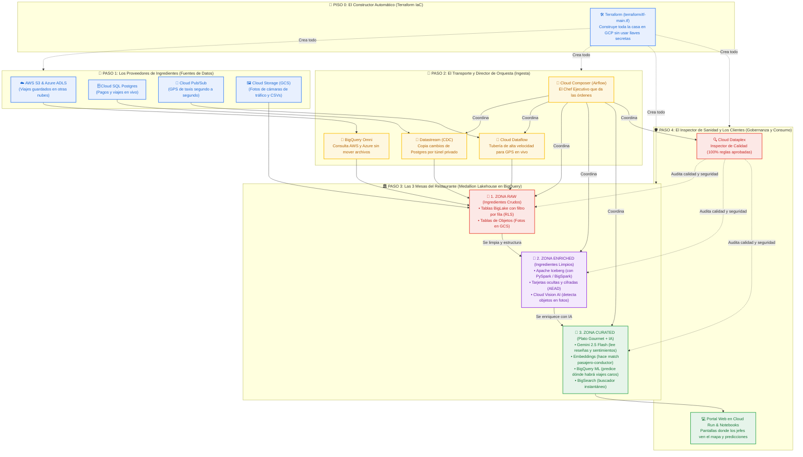

# 🏗️ Arquitectura "For Dummies": Google Cloud Data Analytics Golden Demo

> **Imagina que esta arquitectura es una Gran Cocina Inteligente de un servicio tipo Uber/Rideshare ("Rideshare Plus") en Nueva York.**  
> Nuestro objetivo es recibir ingredientes crudos de todas partes del mundo, lavarlos, cocinarlos con Inteligencia Artificial y servirlos en un plato ejecutivo listo para tomar decisiones en segundos.

---

## 🎨 Mapa Visual de la Arquitectura (En Colores de Google Cloud y Tonos Pasteles)

---

## 🧩 Explicación Paso a Paso "For Dummies" (Sin Palabras Complicadas)

### 🧱 Paso 0: El Constructor con Planos (`terraform/` y `terraform-modules/`)
* **¿Qué es en la vida real?** Antes de cocinar, necesitas construir el restaurante, poner la luz, el agua y las cerraduras.
* **¿Cómo lo hace el demo?** En lugar de hacer clic mil veces en la pantalla de Google Cloud, usa **Terraform** ([`terraform/tf-main.tf`](./terraform/tf-main.tf)).
* **El truco de seguridad:** Usa algo llamado *Impersonation* (disfraz temporal con permiso oficial). Así ningún programador tiene que descargar contraseñas ni llaves `.json` peligrosas a su computadora.

---

### 🚚 Paso 1 y 2: ¿De dónde salen los datos y cómo entran? (Las 4 Tuberías)
La empresa **Rideshare Plus** tiene datos regados por todas partes. Para meterlos a **BigQuery** (nuestro gran almacén inteligente), usa 4 caminos:

1. **Datos en otras nubes (`AWS S3` y `Azure`) $\rightarrow$ `BigQuery Omni`**:
   * *El problema:* Tenemos millones de viajes viejos guardados en Amazon (AWS) y Microsoft (Azure). Traerlos cuesta caro y tarda mucho.
   * *La solución:* **BigQuery Omni** ([`sql-scripts/aws_omni_biglake/`](./sql-scripts/aws_omni_biglake)) viaja hasta AWS y Azure, hace la suma allá mismo y solo nos trae el resumen final.
2. **Base de datos de cobros (`Cloud SQL Postgres`) $\rightarrow$ `Datastream CDC`**:
   * *El problema:* Cada vez que alguien paga un viaje o cambia su tarifa en la base de datos operativa, queremos saberlo al instante sin frenar el sistema de cobros.
   * *La solución:* **Datastream** ([`sp_demo_datastream_private_ip.sql`](./sql-scripts/taxi_dataset/sp_demo_datastream_private_ip.sql)) escucha cada cambio (`INSERT`, `UPDATE`, `DELETE`) por un túnel privado sin internet público (*Private Service Connect*) y lo copia en BigQuery.
3. **Taxis moviéndose en vivo (`Pub/Sub`) $\rightarrow$ `Cloud Dataflow`**:
   * *El problema:* Los taxis mandan su ubicación GPS y el taxímetro cada segundo.
   * *La solución:* **Pub/Sub** recibe los mensajes y **Dataflow** ([`dataflow/streaming-taxi-data.py`](./dataflow/streaming-taxi-data.py)) funciona como una manguera de bomberos que los mete directo a BigQuery en menos de 1 décima de segundo.
4. **Fotos de las calles y archivos sueltos $\rightarrow$ `Cloud Storage` + `BigLake`**:
   * Las fotos de cámaras de tráfico (`.jpg`) y archivos `.parquet`/`.csv` se guardan en cubetas de **Cloud Storage**.

> 🎼 **¿Y quién coordina que todo esto ocurra a tiempo?**  
> **Cloud Composer (Apache Airflow)** ([`cloud-composer/dags/`](./cloud-composer/dags)): Tiene **36 robots programados (DAGs)** que despiertan, prenden las tuberías, revisan que nada falle y apagan lo que no se usa.

---

### 🏛️ Paso 3: Las 3 Zonas del Almacén (Arquitectura Medallion)

Para no mezclar basura con datos limpios, el almacén (**BigQuery**) se divide en **3 salas** (Bronce/Raw $\rightarrow$ Plata/Enriched $\rightarrow$ Oro/Curated):

#### 🥉 Sala 1: ZONA RAW (Datos Crudos pero con Candado)
Aquí caen los datos tal como llegaron, pero ya tienen reglas de seguridad gracias a **BigLake** ([`sp_demo_script.sql`](./sql-scripts/rideshare_lakehouse_curated/sp_demo_script.sql)):
* **Row-Level Security (RLS - Filtro por fila):** Si entra un gerente que solo tiene permiso para ver **Manhattan**, la tabla automáticamente esconde las filas de Queens, Brooklyn y Bronx (de 20 zonas solo le muestra 13).
* **Data Masking (Máscara de datos):** Si no tienes permiso para ver la zona de servicio o una tarjeta, ves `***MASKED***`.
* **Object Tables (Tablas de Fotos):** Aunque sean fotos `.jpg` guardadas en carpetas, BigQuery las muestra como una tabla ordenada con filas y columnas para poder analizarlas.

#### 🥈 Sala 2: ZONA ENRICHED (Datos Limpios, Abiertos y Analizados con Visión Artificial)
Aquí limpiamos y enriquecemos todo ([`sp_iceberg_spark_transformation.py`](./sql-scripts/rideshare_lakehouse_enriched/sp_iceberg_spark_transformation.py)):
* **Apache Iceberg + BigSpark:** Usando código **PySpark dentro de BigQuery**, los datos se guardan en formato **Apache Iceberg** (el estándar abierto más moderno del mundo, para que cualquier motor pueda leerlos sin quedar atrapado).
* **Cifrado AEAD y Crypto-Shredding ("Derecho al Olvido"):** Los números de tarjeta de crédito se guardan enmascarados (`****-****-****-5710`) y cifrados con una llave única por cliente. Si un cliente pide borrar sus datos por ley, simplemente **rompemos su llave** (`[CRYPTO_SHREDDED_KEY_DESTROYED]`). Así nadie podrá volver a leer su tarjeta jamás, pero la contabilidad de la empresa no pierde el monto del viaje.
* **Cloud Vision AI:** Una Inteligencia Artificial mira cada foto de las cámaras de la calle y anota qué hay en la imagen: *"Veo una fila de pasajeros con maletas en el Aeropuerto JFK con 96.8% de seguridad"*.

#### 🥇 Sala 3: ZONA CURATED (El Cerebro con Gemini 2.5 Flash y Machine Learning)
Aquí es donde ocurre la magia de negocio ([`sp_step_00_initialize.sql`](./sql-scripts/rideshare_llm_curated/sp_step_00_initialize.sql) y [`sp_process_data.sql`](./sql-scripts/rideshare_lakehouse_curated/sp_process_data.sql)):
1. **Gemini 2.5 Flash dentro de BigQuery:** Lee miles de comentarios escritos por los pasajeros después de cada viaje. Extrae si el comentario fue **Positivo o Negativo** y resume cómo es cada conductor y cada pasajero:
   * *Ejemplo real de tu simulación:* Descubre que a **Sofía Valdés** le gusta viajar en silencio con el aire acondicionado frío a 68°F para sus llamadas ejecutivas.
2. **Emparejamiento con Embeddings (`text-embedding-005`):** Convierte los gustos de cada pasajero y las cualidades de cada conductor en una lista de números (**vectores**) y calcula quién encaja mejor con quién:
   * *Resultado:* Empareja a **Sofía Valdés** con el conductor **Carlos Mendoza** (quien tiene un auto eléctrico silencioso y fresco) con un **99.94% de compatibilidad**.
3. **BigQuery ML (Predicción del Futuro):** Cruza la hora (18:00), el clima (está lloviendo) y la cantidad de gente que Vision AI vio en las cámaras para predecir dónde habrá viajes de alto valor:
   * *Resultado:* Avista un **96.4% de probabilidad** en **JFK Airport** y **92.8%** en **Times Square**, enviando una alerta para despachar taxis hacia allá.
4. **BigSearch (El Google interno de tus tablas):** Crea un índice para que, si buscas los últimos dígitos de una tarjeta o un ID entre 700 millones de viajes, lo encuentre en milisegundos sin leer toda la tabla.

---

### 🛡️ Paso 4: El Inspector de Calidad (`Cloud Dataplex`) y la Pantalla Final (`Cloud Run`)
* **Cloud Dataplex** ([`sample-dataplex-run-data-quality.py`](./cloud-composer/dags/sample-dataplex-run-data-quality.py)): Es el inspector que revisa que no haya viajes con precio negativo, que ningún ID esté vacío y que todas las tarjetas estén bien enmascaradas. En nuestra simulación aprobó el **100% (5 de 5 reglas)**.
* **Cloud Run Website & Colab Notebooks** ([`cloud-run/rideshare-plus-website/`](./cloud-run/rideshare-plus-website) y [`dashboard_golden_demo.html`](./simulador_end_to_end/dashboard_golden_demo.html)): Es la pantalla amigable donde los directores y operadores ven los mapas, los perfiles hechos por Gemini y las alertas de demanda en vivo.

---

## 🗺️ Diccionario Ultra-Rápido: "¿Qué carpeta de mi proyecto hace qué?"

| Si quieres ver... | Abre esta carpeta en tu proyecto [`end-to-end/`](.) |
| :--- | :--- |
| 🛠️ **Los planos que crean todo en GCP** | [`terraform/`](./terraform) y [`terraform-modules/`](./terraform-modules) |
| 🎼 **Los 36 robots que automatizan las tareas** | [`cloud-composer/dags/`](./cloud-composer/dags) |
| 🗄️ **Las recetas SQL (Raw, Enriched, Curated, Gemini, BQML)** | [`sql-scripts/`](./sql-scripts) |
| 📓 **Los 18 cuadernos interactivos de IA y ciencia de datos** | [`colab-enterprise/`](./colab-enterprise) |
| ⚡ **El código Spark para tablas Apache Iceberg** | [`dataproc/`](./dataproc) |
| 🌊 **La tubería de datos en tiempo real (Streaming)** | [`dataflow/`](./dataflow) |
| 🔍 **Las reglas del inspector de calidad de datos** | [`dataplex/`](./dataplex) |
| 🎮 **Tu simulador local listo para usar y su Dashboard Pastel** | [`simulador_end_to_end/`](./simulador_end_to_end) |
